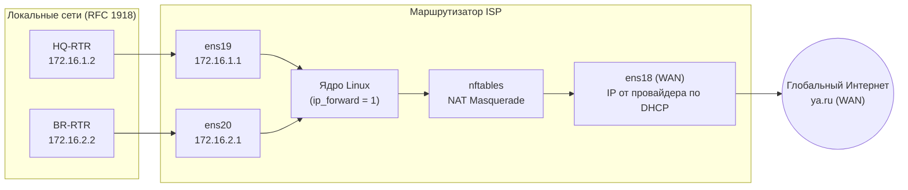

# Задание №2: Доступ к сети Интернет на ISP (2027)

::: tip 📺 Видео-разбор задания
*В процессе разработки*
:::

В данном задании настраивается интернет-провайдер (**ISP**). Его задача — принимать трафик из локальных сетей офисов (**HQ** и **BR**) и выпускать их в глобальную сеть через динамическую трансляцию адресов (**NAT / Masquerade**).

::: info 📍 Место выполнения
Все команды выполняются на виртуальной машине **ISP** (`isp.au-team.irpo`).
:::

---

## 1. Теоретическая справка: что мы настраиваем и зачем?

### Зачем нужен `ip_forward = 1`?
По умолчанию ядро Linux настроено как обычный компьютер (конечный узел): если на его сетевой интерфейс приходит IP-пакет, адресованный не ему, ядро его просто отбрасывает.

Включение директивы `net.ipv4.ip_forward = 1` сообщает ядру: *«Ты теперь маршрутизатор, пересылай транзитные пакеты между разными сетевыми интерфейсами»*.

### Зачем нужен NAT Masquerade?
Сети наших офисов (`172.16.1.0/28`, `172.16.2.0/28`, `192.168.x.x`) относятся к диапазонам приватных IP-адресов ([RFC 1918](https://datatracker.ietf.org/doc/html/rfc1918)). В глобальной сети Интернет эти адреса не маршрутизируются.

Механизм **Masquerade** («Маскарад» / разновидность динамического PAT/NAPT) подменяет обратный «серый» IP-адрес источника в пакете на реальный IP-адрес внешнего интерфейса **`ens18`**, полученный от магистрального интернет-провайдера. Когда из Интернета возвращается ответный пакет, ISP по таблице состояний трансляций возвращает пакет обратно нужному офисному узлу.



---

## Шаг 1. Включение маршрутизации пакетов в ядре

В ALT Linux глобальные системные параметры ядра для сетевой подсистемы задаются в файле `/etc/net/sysctl.conf`.

### Вариант А: Редактирование в Vim
Открываем конфигурационный файл сетевых параметров ядра:
```bash
vim /etc/net/sysctl.conf
```

::: tip 💡 Памятка по работе в Vim
* Вход в режим редактирования: нажмите клавишу <kbd>i</kbd>.
* Выход в командный режим: нажмите <kbd>Esc</kbd>.
* Сохранить изменения и выйти: введите `:wq` и нажмите <kbd>Enter</kbd> (или `:q!` для отмены и выхода без сохранения).
:::

Находим строку `net.ipv4.ip_forward` и меняем значение с `0` на `1`:
```ini
net.ipv4.ip_forward = 1
```

### Вариант Б: Быстрое добавление одной командой
Если вы хотите применить настройку без открытия текстового редактора:
```bash
echo "net.ipv4.ip_forward = 1" >> /etc/net/sysctl.conf
```

### Применение параметров ядра
Перезапускаем сетевую подсистему `etcnet`, чтобы ALT Linux применил новые системные параметры:
```bash
systemctl restart network
```

---

## Шаг 2. Установка и настройка межсетевого экрана nftables

В ALT Linux современным стандартом управления правилами трансляции и межсетевой фильтрации является **`nftables`** (пришёл на замену устаревшему `iptables`).

### 2.1. Установка пакетов
Обновляем кэш репозиториев и устанавливаем пакет `nftables`:
```bash
apt-get update && apt-get install nftables -y
```

### 2.2. Создание файла с правилами трансляции (NAT)
Создаём конфигурационный файл правил `/etc/nftables/nftables.nft`:
```bash
nano /etc/nftables/nftables.nft
```

::: warning ⚠️ Важно
Если в файле присутствует шаблонная или старая конфигурация, **полностью удалите её** перед вставкой наших правил.
:::

Вставляем следующий текст конфигурации:
```bash
#!/usr/sbin/nft -f

flush ruleset

table ip nat {
    chain postrouting {
        type nat hook postrouting priority srcnat;
        oifname "ens18" masquerade
    }
}
```

#### 🔍 Разбор каждой строчки конфигурации:
* **`#!/usr/sbin/nft -f`** — шебанг, указывающий оболочке, что данный файл является исполняемым скриптом правил nftables.
* **`flush ruleset`** — сброс правил. Полностью очищает текущую таблицу правил в оперативной памяти перед загрузкой, предотвращая задваивание цепочек и правил при повторном запуске.
* **`table ip nat { ... }`** — объявляет таблицу с именем `nat` для протокола IPv4 (`ip`).
* **`chain postrouting { ... }`** — создание цепочки пост-маршрутизации. Срабатывает в самый последний момент — когда маршрутизатор уже принял решение о маршрутизации и определил, через какой сетевой интерфейс вытолкнуть пакет наружу.
* **`type nat hook postrouting priority srcnat;`** — регистрирует цепочку в стандартном хуке ядра Netfilter для подмены адреса источника (`srcnat`).
* **`oifname "ens18" masquerade`** — главное правило: для всех пакетов, покидающих маршрутизатор через внешний WAN-интерфейс `ens18` (*Outbound Interface Name*), производить динамическую маскировку (подменять адрес источника на реальный IP-адрес интерфейса `ens18`).

### 2.3. Запуск и добавление в автозагрузку
Чтобы правила трансляции гарантированно поднимались после перезагрузки виртуальной машины на демонстрационном экзамене, активируем автозапуск службы:
```bash
# Включаем службу в автозапуск и сразу запускаем её:
systemctl enable --now nftables

# Принудительно очищаем текущие правила и мгновенно применяем наш конфигурационный файл:
nft flush ruleset
nft -f /etc/nftables/nftables.nft
```

::: tip 💡 Что делает ключ `nft -f`?
Ключ `-f` (*file*) компилирует и мгновенно загружает набор правил из указанного текстового файла прямо в ядро Linux без перезапуска демона.
:::

---

## Шаг 3. Проверка работоспособности (Верификация)

На демонстрационном экзамене обязательно убедитесь, что все настройки применились и работают корректно.

### 1. Проверяем статус правил трансляции в ядре
```bash
nft list ruleset
```

**Ожидаемый вывод:**
Консоль должна вывести блок `table ip nat` ровно с теми правилами, которые мы внесли в конфигурационный файл:
```text
table ip nat {
	chain postrouting {
		type nat hook postrouting priority srcnat; policy accept;
		oifname "ens18" masquerade
	}
}
```
> *Если вывод команды пустой — правила не были загружены. Повторите команду `nft -f /etc/nftables/nftables.nft`.*

### 2. Проверяем статус пересылки транзитных пакетов
```bash
sysctl net.ipv4.ip_forward
```

**Ожидаемый вывод:**
```text
net.ipv4.ip_forward = 1
```

### 3. Проверяем доступность внешнего Интернета

#### 3.1. Проверка доступности на самом ISP
Отправляем 4 ICMP-запроса к публичному DNS-узлу или поисковику:
```bash
ping -c4 ya.ru
```

**Пример успешного вывода на ISP:**
```text
[root@isp ~]# ping -c4 ya.ru
PING ya.ru (77.88.55.242) 56(84) bytes of data.
64 bytes from ya.ru (77.88.55.242): icmp_seq=1 ttl=128 time=54.7 ms
64 bytes from ya.ru (77.88.55.242): icmp_seq=2 ttl=128 time=54.6 ms
64 bytes from ya.ru (77.88.55.242): icmp_seq=3 ttl=128 time=54.1 ms
64 bytes from ya.ru (77.88.55.242): icmp_seq=4 ttl=128 time=54.4 ms

--- ya.ru ping statistics ---
4 packets transmitted, 4 received, 0% packet loss, time 3005ms
rtt min/avg/max/mdev = 54.143/54.464/54.669/0.210 ms
```
*Успешные ответы (`0% packet loss`) подтверждают, что интерфейс `ens18` получил сетевые настройки по DHCP и служба разрешения имен DNS работает штатно.*

#### 3.2. Проверка доступа из офисных маршрутизаторов (HQ-RTR и BR-RTR)
После выполнения Задания №1 на маршрутизаторах `HQ-RTR` и `BR-RTR` настроены шлюзы по умолчанию в сторону `ISP` (`172.16.1.1` и `172.16.2.1`).

Проверяем сквозной выход в глобальную сеть с `HQ-RTR` и `BR-RTR`:
```bash
# На узлах HQ-RTR и BR-RTR:
ping -c4 ya.ru
```

Если пакеты успешно проходят через `ISP` в Интернет и возвращаются обратно — задание выполнено в полном объёме! 🎉

---

## ⚡ Шпаргалка для быстрого выполнения на экзамене

Все действия на узле **ISP** одной последовательностью команд:

```bash
# 1. Включаем форвардинг пакетов
echo "net.ipv4.ip_forward = 1" >> /etc/net/sysctl.conf
systemctl restart network

# 2. Устанавливаем nftables
apt-get update && apt-get install nftables -y

# 3. Записываем конфигурацию NAT Masquerade
cat << 'EOF' > /etc/nftables/nftables.nft
#!/usr/sbin/nft -f

flush ruleset

table ip nat {
    chain postrouting {
        type nat hook postrouting priority srcnat;
        oifname "ens18" masquerade
    }
}
EOF

# 4. Включаем службу и загружаем правила
systemctl enable --now nftables
nft flush ruleset
nft -f /etc/nftables/nftables.nft

# 5. Проверяем работу
nft list ruleset
sysctl net.ipv4.ip_forward
ping -c4 ya.ru
```
